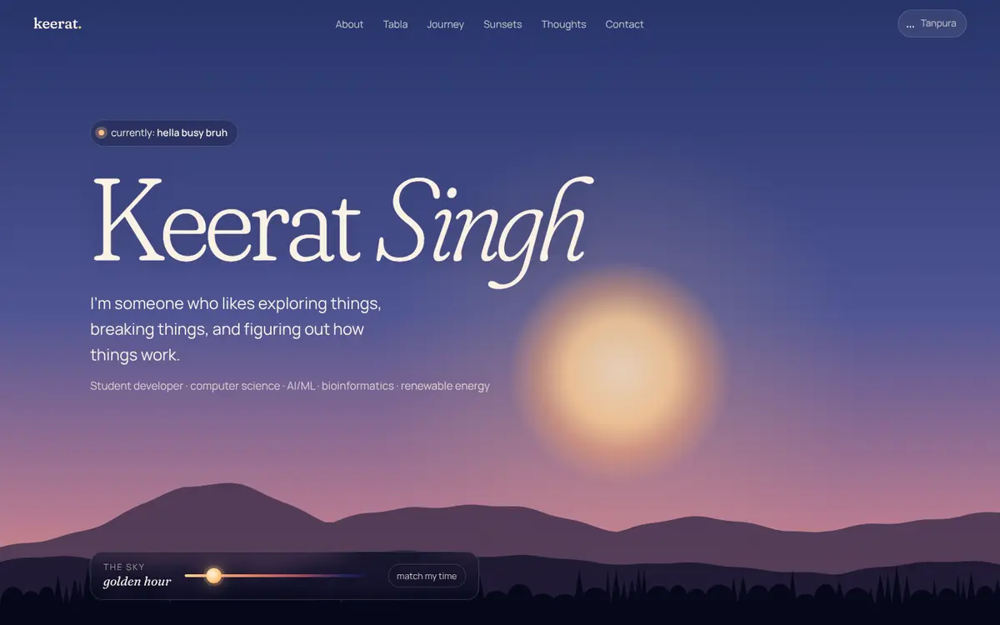
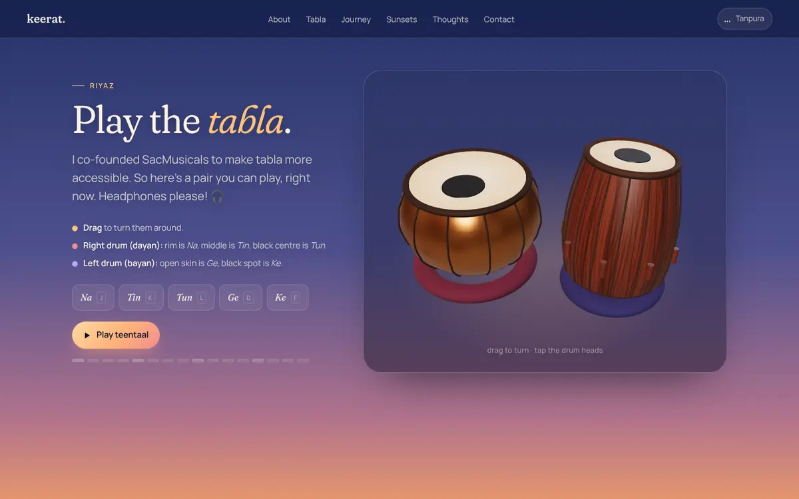
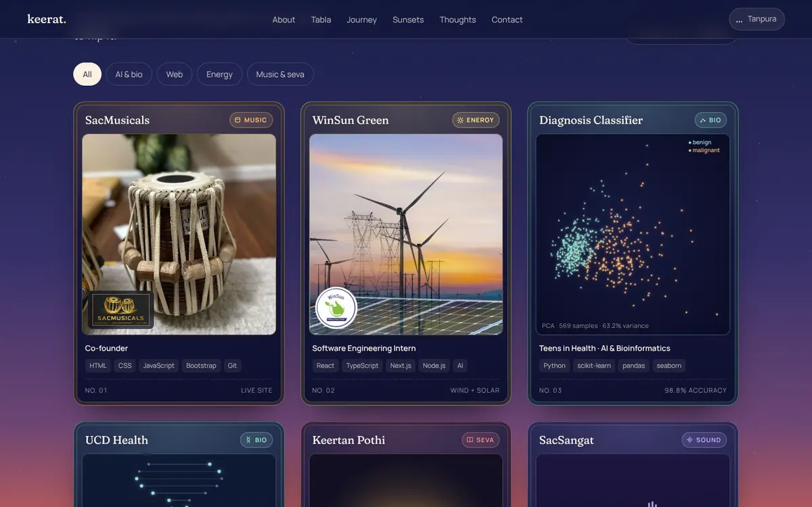

# keerat.fyi

My personal website. It's one long scroll through an evening: the page opens at golden hour, and the sky gets darker as you go down until it's night by the time you reach the bottom.

**Live:** [www.keerat.fyi](https://www.keerat.fyi)



---

## About Me

I'm a high school student interested in computer science, AI/ML, bioinformatics, and renewable energy. I like exploring things, breaking things, and figuring out how things work.

I wanted this site to show what I'm working on and also what I'm into: sunsets, tabla and kirtan, Pokémon, and philosophy.

---

## What's on the Site

- **A sky that follows my clock.** The colors match the current time where I am. You can drag the sky slider to move the sun down into night.
- **A tabla you can play.** It's a 3D pair you can drag to turn around and tap to play. Different spots on the drum heads play different strokes (*Na, Tin, Tun, Ge, Ke*), and the **Play teentaal** button plays the full 16-beat cycle. The keyboard works too: J K L D F.
- **Tanpura.** The button in the corner turns on a soft background drone. It's off until you click it.
- **Project cards.** My projects are collectible cards. Flip each one to read about it, filter them by topic, and flip all six to complete the collection.
- **Gallery.** Every post from my photo account, [@inkeeratseyes](https://www.instagram.com/inkeeratseyes/), copied over automatically once a day. Tap one to see it bigger with its caption.
- **Sunsets.** Photos I've taken, sorted from golden hour to last light. Hover over one and the page glows with its colors; click to see it full size.
- **Thoughts.** A few ideas I care about, with a shooting star when you click for the next one.
- **Contact.** My socials, drawn as a constellation.





---

## Projects Featured

| Project | What it is |
|---|---|
| [SacMusicals](https://www.sacmusicals.com) | Website for a local business that makes and repairs tablas ([code](https://github.com/codingwithdaas/sac-musicals)) |
| WinSun Green | Software engineering internship at a renewable energy company ([code](https://github.com/codingwithdaas/winsun-green-website)) |
| Breast cancer diagnosis classifier | ML project from the Teens in Health AI & Bioinformatics cohort, 98.8% test accuracy, published in the [Teens in Health journal](https://teensinhealth.org/ourpublications/2026/9/20/ai-amp-bioinformatics-journal-summer-2026) (pg. 277) ([code](https://github.com/codingwithdaas/breast-cancer-ml-classification)) |
| [Discovery Engine](https://github.com/codingwithdaas/discoveryengine) | Bioinformatics & ML research at UCD Health: searches tumor data for biomarkers, then tries hard to prove each one is fake |
| [Keertan Pothi](https://keertanpothi.org/support) | Frontend, testing and SEO for a Sikh scripture preservation platform ([my fork](https://github.com/codingwithdaas/KeertanPothWeb1500px)) |
| [SacSangat Media Seva](https://soundcloud.com/sac-sangat) | Audio engineering: 550+ recordings, 300K+ plays, 50 countries |

The star map on the classifier card is real data: a PCA projection of all 569 samples from the Wisconsin Diagnostic dataset, computed the same way as in the project repo.

---

## Tech Stack

- HTML / CSS / JavaScript (no framework, no build step)
- [three.js](https://threejs.org) for the 3D tabla
- Web Audio API for every sound. The tabla strokes and the tanpura are generated in code, so there are no audio files.
- Canvas for the stars, the PCA star map, the DNA helix, and the waveform
- Fraunces and Manrope fonts, self-hosted
- A daily GitHub Action that copies my Instagram posts into the site (`scripts/instagram_sync.py`)
- Hosted on Vercel
- Love :D

It also respects accessibility settings. Everything works with a keyboard, and if your device is set to reduce motion, the animations stop.

---

## Project Structure

```
index.html            the whole page
assets/
  styles.css          all the styling
  main.js             the sky, stars, sky slider, tabla controls
  sections.js         cards, sunsets, thoughts, contact
  audio.js            tabla strokes + tanpura drone
  tabla.js            the 3D tabla (bundled three.js, loads only when you scroll to it)
  data/pca.json       data points for the PCA star map
  data/instagram.json the Gallery's posts (written by the daily sync, don't edit by hand)
  img/                photos and project images
  img/ig/             the Gallery's photos (also written by the sync)
  fonts/              Fraunces + Manrope
src/tabla.js          source for the 3D tabla
scripts/instagram_sync.py   copies Instagram posts into the site
.github/workflows/instagram.yml   runs that script once a day
docs/                 screenshots for this README
DESIGN.md             notes on how the design works
```

---

## Running It Locally

There's nothing to install. Serve the folder with any static server:

```bash
python3 -m http.server 8000
```

Then open `http://localhost:8000`.

Opening `index.html` directly as a file won't fully work, because the browser blocks the tabla and the star map data from loading over `file://`.

### Changing the 3D tabla

The tabla's source is `src/tabla.js`. After editing it, rebuild the bundle:

```bash
npm install
npm run build:tabla
```

That's the only step that needs npm. The rest of the site is plain files.

---

## Editing Content

- **Thoughts:** add to the `THOUGHTS` list in `assets/sections.js`
- **Projects:** edit the `<article class="card">` blocks in `index.html`
- **Sunset photos:** add an item to the `#strip` list in `index.html` (`data-glow` is the color the page glows with)

More detail is in [DESIGN.md](DESIGN.md).

---

## Gallery: syncing Instagram

Once a day, a GitHub Action asks Instagram for every post on @inkeeratseyes, saves its own copies of the photos into `assets/img/ig/`, writes `assets/data/instagram.json` and commits. Vercel redeploys on that commit. The section stays hidden until there's at least one post. Deleted posts disappear from the site on the next sync.

It only works with a **Professional (Creator) account**, because Instagram no longer lets websites read personal accounts. Everything involved is free.

**One-time setup**

1. **Creator account.** In the Instagram app on @inkeeratseyes: Settings → Account type and tools → Switch to professional account → Creator.
2. **Meta app.** At [developers.facebook.com/apps](https://developers.facebook.com/apps), create an app with the **Manage messaging & content on Instagram** use case and connect it to a business portfolio (free).
3. **Token.** In the use case, open **API setup with Unified login**, add @inkeeratseyes and generate a system-user access token. These tokens don't expire.
4. **`IG_TOKEN` secret.** In this repo on GitHub: Settings → Secrets and variables → Actions → New repository secret. Name it `IG_TOKEN` and paste the token. (Optional: if the sync can't find the account by itself, also add its Instagram account ID as `IG_USER_ID`.)
5. **First run.** Actions tab → Sync Instagram gallery → Run workflow.

An older Instagram-login token (60 days, graph.instagram.com) also works. The sync then renews it every run, and needs a second secret, `GH_PAT`: a fine-grained GitHub token for this repo with **Secrets: Read and write**, so it can save the renewed token.

To sync right after posting, use **Run workflow** again instead of waiting for the next day. If a run fails, its log says why. Usually the fix is generating a new token and replacing `IG_TOKEN`.

Because the Action commits to `master`, run `git pull` before you push your own changes.

---

## Contact

- GitHub: [github.com/codingwithdaas](https://github.com/codingwithdaas)
- Email: codingwithdaas@gmail.com
- LinkedIn: [linkedin.com/in/keerat-s08](https://linkedin.com/in/keerat-s08/)

---

> "Every mistake is a data point to improve your mental model."
